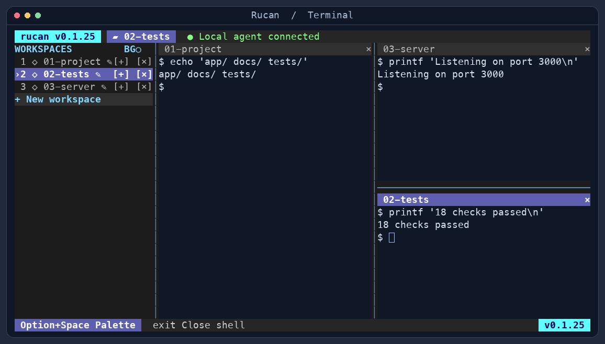

# rucan

**All You Can.** Rucan brings local and SSH workspaces, file navigation, and persistent terminal sessions into one terminal-native workspace manager.

Open a shell and decide later whether to keep it running. The native agent owns each session from the start and keeps it alive across client disconnects. Native sessions require no tmux. Agents and host reboots end the lifetime of the running processes.



```sh
npx --prefer-online rucan@latest
```

Follow the [illustrated workspace guide](docs/workspaces.md) to arrange terminal panes, edit SSH aliases, and resume remote work.

## Run from source

The current build opens a native local shell, discovers running sessions, and supports pinning, switching, detaching and reattaching. The same interface opens SSH sessions and explores local or remote files. The optional tmux backend discovers existing sessions without taking ownership of them.

```sh
pnpm install --frozen-lockfile
pnpm build
pnpm dev
```

Type `exit` at the shell prompt to close the current shell. Open the command palette with [Option+Space on macOS or Alt+Space on Linux and WSL](#palette-shortcuts). You can also click the palette shortcut in the footer. Search for **Close UI and keep sessions** to detach, or **Quit Rucan** to exit immediately using `defaults.on_exit` (keep all sessions by default). The first launch creates a sample at `~/.config/rucan/config.yaml` or under an absolute `XDG_CONFIG_HOME`.

```yaml
version: 1
workspaces:
  - name: local-shell
    cwd: "~"
    command: bash
  - name: gpu-server
    host: gpu-server
    cwd: "~/project"
    persistence: persistent
```

The numbered workspace list contains running sessions. When the selected session exits, Rucan opens the next running session. Closing the last session exits the full-screen UI and restores the terminal screen from before launch. Use the sidebar or search the palette by workspace name or number to switch sessions.

Click **+** next to a workspace to open another session at that workspace's current directory. For an interactive SSH tab created through the palette or `rucan new ssh user@host`, it connects to the same destination and uses the reported directory when available. If that directory is unavailable, SSH opens in its default directory. When a shell is running a foreground `ssh user@host` command, the new tab connects to the same destination. Use an SSH config alias to reuse custom ports, identities, or jump hosts. Local SSH tabs opened by Rucan share an authenticated OpenSSH connection for the same destination. After the first login, opening another tab with **+** starts a separate remote shell over that connection. Reopen SSH connections created without sharing once to enable it. Click **BG** to pin or unpin the selected managed session.

Choose **SSH connect and resume** from the local command palette when the server has tmux. Rucan keeps the local tab open and retries interrupted connections. Press Enter during the wait to retry immediately or Ctrl+C to stop. Complete the OpenSSH password prompt if it appears to return to the same remote tmux session. Each **+** tab gets its own resumable session.

The **+ New workspace** row below the sidebar session list opens a chooser. Select **localhost** to start a local shell, even when the selected session is SSH, or choose an alias from the local `~/.ssh/config`. Type to filter. The **New workspace** action in the palette opens the same chooser. Choose **Edit SSH config** from the chooser or the local palette to open the user configuration in the configured editor in the work area. Reopen the chooser after saving to see the latest aliases.

Choose **×** on a Rucan-managed workspace row to review and confirm closing that session.

Default sidebar names show the host and final directory component, such as `localhost / project` or `192.0.2.7 / app`. Managed SSH tabs show the server IP when reported by the shell. Until then, the address comes from the SSH destination. New shells opened with the row's **+** use an automatic label even when the source has a custom name. The selected workspace updates as its directory changes. Click the pencil (✎) beside a session name to open the rename dialog and replace the automatic label. Type a new name and press Enter to save, or clear the field and save to restore the automatic name. Press Esc or click outside the dialog to cancel. Drag the sidebar divider to resize it. The divider highlights while dragging, and compatible terminals show a horizontal resize pointer. Use the palette to hide the sidebar, show it, or move it to the other side.

**Browse files** opens the selected session's current directory on its host. Select a supported local video, audio file, image, or PDF and press `V` to open it in the system's default application. A plain SSH tab needs the remote shell to report its directory and a reachable agent on the destination.

Inside a managed shell, run `rucan` to see session commands. Use `npx rucan@latest` if you run Rucan through npm without a global installation.

`pnpm dev config` validates the configuration and prints its path. The npm package also supports a global installation:

```sh
npm install -g rucan
rucan
```

Development targets macOS and Linux with Node 22 LTS and Rust stable. The initial implementation was validated on Apple Silicon. The release candidate targets AMD64 and ARM64 on both operating systems.

See the [architecture](docs/architecture.md) for the client, transport and agent diagram, [security](docs/security.md) for trust boundaries and [development](docs/development.md) for build and test commands. Contributions follow [CONTRIBUTING.md](CONTRIBUTING.md). RUCAN is licensed under [Apache-2.0](LICENSE).

## Palette shortcuts

- **macOS · Option+Space**. Configure your terminal's Option key to act as Meta or Esc+ so it sends Escape followed by Space. In iTerm2, this setting is in **Settings → Profiles → Keys**. You can also map Option+Space to **Send Hex Code** with `0x1b 0x20`.
- **Linux and Windows via WSL · Alt+Space**. The terminal must pass the chord through. If Windows Terminal opens the window menu, add this entry to the `actions` array in `settings.json`. See [Windows Terminal send-input bindings](https://learn.microsoft.com/en-us/windows/terminal/tips-and-tricks#send-input-commands-with-a-key-binding).

  ```json
  {
    "command": { "action": "sendInput", "input": "\u001b[32;3u" },
    "keys": "alt+space"
  }
  ```

The palette button in the footer also opens the command palette. Drag across a terminal pane to highlight text and copy it on release. To use your terminal's native selection instead, choose **Select terminal text** in the palette. Use the keyboard shortcut to reopen the palette and choose **Resume mouse controls** to restore sidebar and pane clicks.

## Split the work area

Drag a session by the number at the left of its sidebar row to an edge of a terminal pane. The highlighted area shows where the new pane will appear. Move between the left, right, top, and bottom edges to change the preview, then release to place the session. Drag an already visible session the same way to move it. Release in the center or outside the work area, or press Esc, to cancel.

Show up to four sessions at once. Click a pane to send keyboard input to its session, and drag the divider between panes to resize them. Click **×** in a pane's header to hide it and keep the session running in the sidebar. Drag the session back into the work area to see its output again.

If the terminal becomes too small for the split layout, Rucan shows the focused session until there is room again. Pane placement lasts for the current UI run.

## Known limits

- Native sessions survive client disconnects while their agent and host remain running. Host logout policies can stop detached agents.
- SSH opens with an already trusted host key and non-interactive authentication. Use OpenSSH first to approve a new host key.
- The current directory listing and preview limits are 500 entries and 64 KiB. Terminal viewports are bounded to 12,000 cells.
- Bash, Zsh, Vim and tmux have PTY coverage. Codex onboarding did not complete in the isolated PTY fixture. Codex, Claude Code and Neovim interoperability remains unverified.

See [remote setup](docs/remote.md), [distribution and release candidates](docs/distribution.md), and [measured performance](docs/performance.md). Local and remote sessions share the same Rust agent and protocol.
