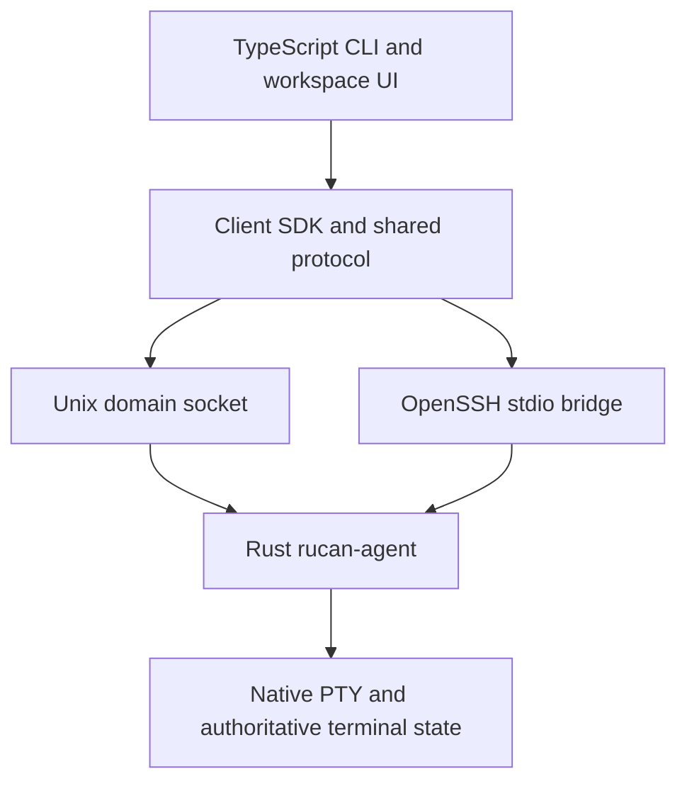

# Architecture

The CLI loads configuration and renders local and remote agent sessions from a validated cell grid. The Rust agent binds a private Unix socket and owns the PTYs and screen state. The Ink fixture and portable PTY example remain isolated test harnesses. Extract an SDK package when the first IPC consumer exists. Add a core package when logic has a second consumer or a meaningful dependency boundary.

The CLI owns the split layout, pane focus, and drag preview for the current UI run. A pane references an agent session ID. The compositor renders visible sessions from their cell grids and routes keyboard input to the focused session through its input lease. Narrow terminals temporarily show only the focused session while preserving the split layout. The agent continues to own each PTY and its scrollback independently of pane placement.

The agent retains the destination of interactive OpenSSH tabs in their session descriptions. The CLI uses it to start a separate SSH connection when the user opens a new session from that tab.

The CLI resolves the selected session's working directory before opening the file explorer. The agent looks up an active PTY child's directory on its host and retains the latest OSC 7 path reported by the terminal.

| Boundary                                             | Owner                   |
| ---------------------------------------------------- | ----------------------- |
| Config defaults, parsing and validation              | CLI config module       |
| Selection, shortcuts and presentation                | CLI UI                  |
| Framing, negotiation and transports                  | Client protocol module  |
| Session identity, lifecycle, filesystem RPC          | Rust agent              |
| Terminal parsing, snapshot sequencing and scrollback | Rust agent              |
| Terminal cell composition and input routing          | CLI compositor          |
| Local versus remote connection                       | Transport selection     |
| Native versus tmux process ownership                 | Agent backend selection |

Keep persistence separate from location and backend. Share filesystem RPC and explorer logic across local and remote connections. Use a single schema to validate metadata in both languages. Keep UTF-8/control parsing in the emulator and screen encoding in the presentation boundary.

## Remote deployment

Use the configured OpenSSH alias so existing authentication, jump hosts, identity selection and host key verification apply. Probe OS, CPU and runtime constraints using fixed commands. Check the existing agent and negotiate before suggesting installation. After approval, send an authenticated artifact from the client over SSH and install atomically in a user-owned directory. A fixed stdio bridge will connect to the same private socket as local clients. Test a detached process or user service under Linux logout policies and macOS launch contexts. Stage artifacts and exercise all four target platforms before claiming support.

## Checkpoints

- Phase 0 exercises real PTYs, verifies bounded terminal buffering, records measured timings and documents the unresolved rendering and recovery questions.
- Phase 1 requires strict typecheck, lint, build and tests, a first-launch config with restrictive permissions, and a real TTY smoke test for the fixture layout and exit.
- Phase 2 requires identical child PID across a pin/unpin and detach/reattach sequence, single-winner concurrent startup, and bounded recovery after a stalled reader.
- Phase 3 requires full-screen Vim, safe Unicode and color composition, paste and mouse handling, resize, and raw-mode restoration. Codex and Claude Code require manual verification.
- Phase 4 requires a remote host without Node.js or tmux and reattachment to the original child from a second client after the originating client host stops.
