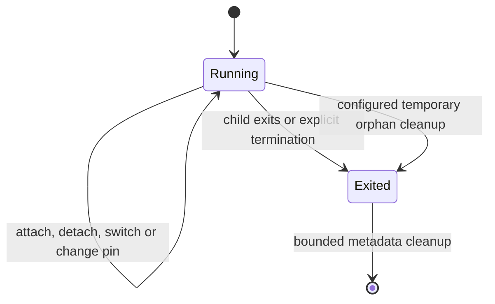

# Session lifecycle

The agent creates the PTY and retains ownership across client detach, crash or SSH loss while the host leaves the daemon running. Pinning changes metadata on the same live session. A session can have multiple observers, with one explicitly granted input and resize lease.

When the selected session ends, the UI switches to the next running session. When the last running session ends, the UI exits and restores the terminal's original screen.

Quit Rucan closes the UI immediately and applies `defaults.on_exit`. The default and legacy `ask` setting keep all sessions. Explicit `keep-pinned` and `terminate` settings still apply to managed sessions. External tmux sessions require independent ownership handling. Temporary orphan retention is opt-in and should only run when the session is unpinned and has no clients. Persisted metadata cannot resurrect a process after the agent or host stops.

Remote process survival depends on SSH detach and the host's user process cleanup policy. Detect unsupported environments and report them to the user. System policies require administrator control.

## Local native agent

The local agent now owns native PTYs across Unix socket connections. The first controller owns the input and resize lease, and later connections can observe. Closing the controlling connection releases its lease while preserving the running child. Temporary and persistent sessions both survive disconnect. Startup lock ownership prevents competing agents from claiming the same private socket.

A Tokio task exclusively owns each child handle and uses SIGCHLD notifications to reap it. This avoids races between a reaper and a termination request using a recycled PID. Dedicated bounded input workers keep blocked PTY writes off the connection loop. The terminal parser processes output with a bounded scrollback even when watchers are absent.

The sidebar BG control changes the pin on the selected managed session. The pin is used by the keep-pinned exit policy. Choosing to close the UI and keep all sessions retains both pinned and unpinned sessions.
