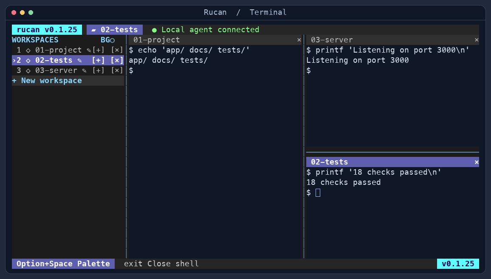
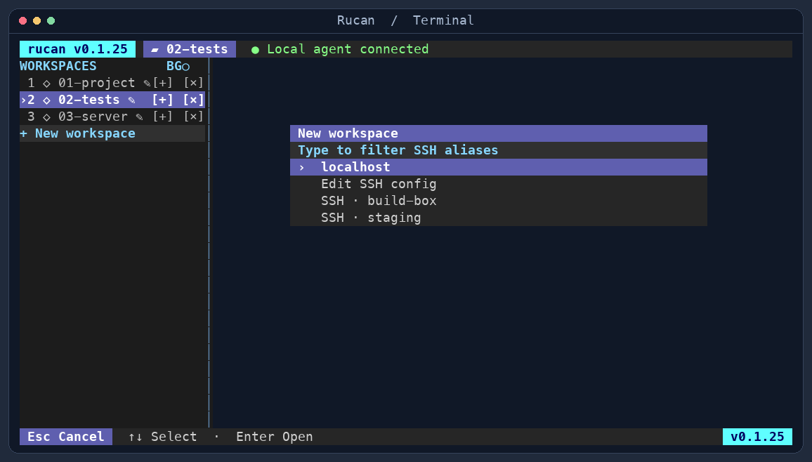
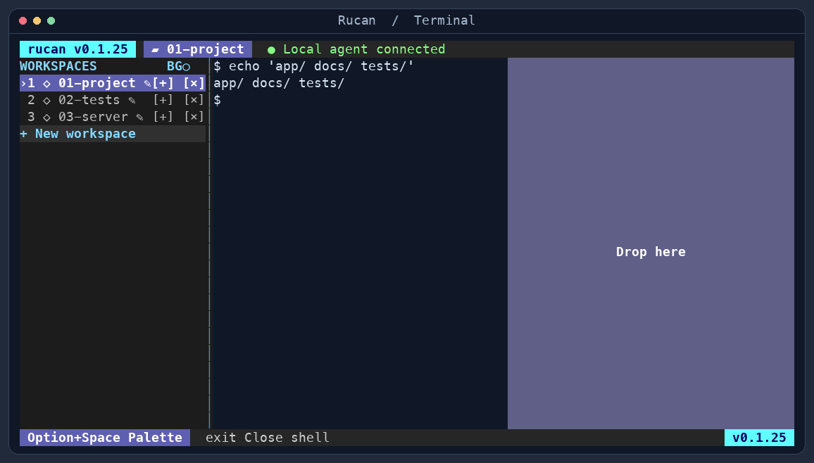
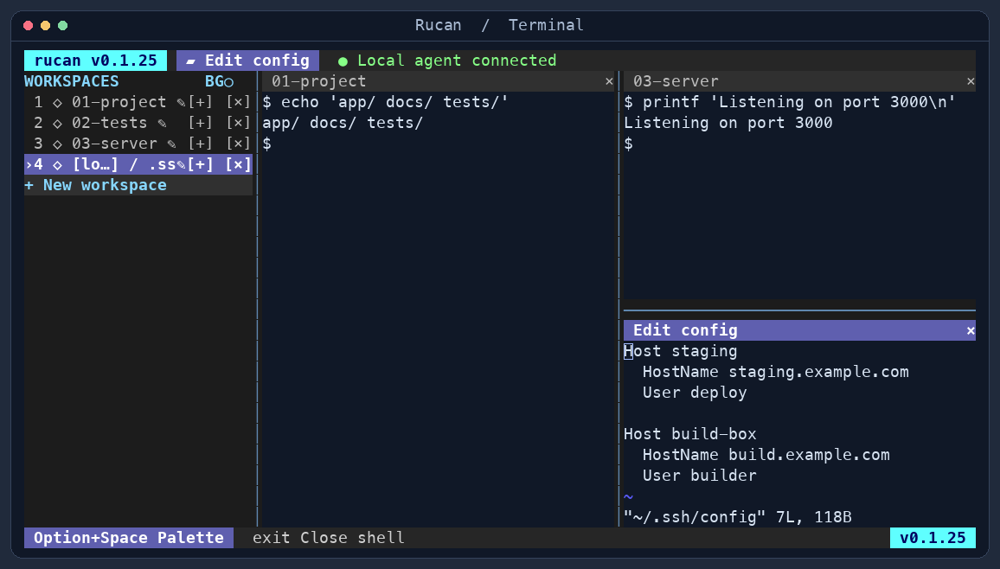

# Rucan workspace guide

Keep a project shell, a test runner, and a dev server visible in one terminal. Add an SSH workspace from the same sidebar and return to running sessions after closing the interface.



_Captured from Rucan 0.1.25 on macOS with demo shell output and example SSH hosts._

## Start a workspace

```sh
npx --prefer-online rucan@latest
```

Click **+ New workspace** at the bottom of the sidebar. Select **localhost** to open a local shell, or type to filter the SSH aliases from your local OpenSSH config.



The **+** beside a workspace opens another shell on the same connection. Its sidebar label starts as an address and folder, such as `localhost / project`. Rucan uses the current directory when it can determine it. For a local Rucan-managed SSH tab, the new shell can share the authenticated OpenSSH connection for that destination.

## Arrange terminals side by side

1. Grab a workspace by its number in the sidebar.
2. Hover near the left, right, top, or bottom edge of a terminal pane. The **Drop here** highlight shows where it will appear.
3. Release to place it. Drop in the center or press **Esc** to cancel.



You can display up to four terminals. Click a pane to focus it, drag the divider to resize it, or drag its workspace number again to move it. Clicking **×** in a pane header hides the pane and keeps the session running in the sidebar. The sidebar **×** opens a confirmation to end the session.

## Edit SSH aliases in the work area

From **+ New workspace**, choose **Edit SSH config**. The editor opens on the right. Save your changes, close the editor, and reopen the chooser to see the updated aliases. The local command palette also offers **Edit SSH config**.



For network interruptions, use **SSH connect and resume** from the local command palette when the server has tmux. Rucan retries the connection and reattaches to the remote tmux session. Press **Enter** to retry immediately during a wait, or **Ctrl+C** to stop. If OpenSSH prompts for your password again, complete the prompt in the terminal. See [remote setup](remote.md) for the agent-backed workflow.

## Keep working across sessions

| Action                                | Where to find it                                                                                                                        |
| ------------------------------------- | --------------------------------------------------------------------------------------------------------------------------------------- |
| Rename a workspace                    | Click the pencil beside its name, then press **Enter** to save.                                                                         |
| Browse files                          | Open **Browse files** in the palette. Press **V** on a supported local video, audio file, image, or PDF to open it in your default app. |
| Close the interface and keep sessions | Choose **Close UI and keep sessions** in the palette. Reopen Rucan to find the running sessions.                                        |
| End the focused shell                 | Run `exit` in the shell. Closing the last session restores the original terminal screen.                                                |

Open the palette with **Option+Space** on macOS or **Alt+Space** on Linux. You can also click its shortcut in the footer. Drag across a terminal pane to copy text. For your terminal's native selection, choose **Select terminal text**, then **Resume mouse controls** from the keyboard palette when done. Native sessions depend on their agent and host staying up. Split placement belongs to the current UI run.
